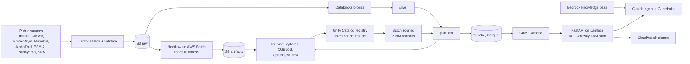

# QAFI ML Platform

**A protein stability and function model, and the platform that builds, tests and serves it.**

Given a protein sequence and a structure, it predicts what a mutation costs in two physical quantities —
how much harder the protein is to fold, and how much worse it works once folded — in kcal/mol. Those two
numbers say *which kind of damage* a mutation does, which a single score cannot.

Around the model is the system a company would run: public data ingested into S3 and a governed
Databricks lakehouse, leakage-proof validation with a test set opened once, MLflow tracking, a gated
registry, 218 million variants batch-scored, a serverless API, a Bedrock knowledge base and agent, and
Nextflow pipelines on AWS Batch — all in Terraform with CI/CD.

It rebuilds [QAFI](https://doi.org/10.1007/s00439-024-02692-z) (ranked first in the CAGI7 LPL and ATP7B
challenges) from research scripts into that system.

## What it can do

| | Result | Where |
|---|---|---|
| **Predict folding stability in kcal/mol** | Median Spearman 0.76 per domain on the published mega-scale split, against ThermoMPNN's 0.77 and SPURS' 0.83; beats a zero-parameter conservation × burial baseline (0.58) | [14a](notebooks/F_science/14a_stability_kcal.ipynb) |
| **Turn sequencing reads into fitness** | Reprocessed a published experiment from raw FASTQ: **Pearson 1.0000** against the authors' deposited values, on both phenotypes | [14b](notebooks/F_science/14b_reads_to_fitness.ipynb) |
| **Separate stability from function** | On KRAS, held out with its only relative: the folding energy tracks measured folding, the functional energy tracks binding to all six partners — **7 of 7** in direction, 6 significant when whole positions are resampled; two more held-out proteins (CYP2C9, G6PD) agree on the folding side. One ESM-2 score gives the same answer for both | [14c](notebooks/F_science/14c_two_energies.ipynb) |
| **Predict combinations** | Energies add: ~5,000 unseen double mutants of a training protein at **R² 0.74 and 0.84** (singles to doubles); adding fitness instead gives a negative R². On the published double-mutant benchmark, the 22,081 doubles of the held-out domains, summing our singles scores **0.496 Spearman** against ThermoMPNN-additive's 0.45 and SPURS-additive's 0.52 | [14c](notebooks/F_science/14c_two_energies.ipynb), [14a](notebooks/F_science/14a_stability_kcal.ipynb) |
| **Map what each position is for** | Positions called functionally costly are enriched **2.8×** for UniProt active and binding sites (structural ones are depleted). The KRAS switch-II and ABL1 myristoyl pockets, which marketed drugs bind, land in the top quarter of their own protein. Served through the API and the agent | [14d](notebooks/F_science/14d_site_map.ipynb) |
| **Tell which variants a drug can rescue** | Migalastat's published amenability list for GLA: **AUROC 0.769** against 0.725 for a zero-shot language model, on a protein absent from every split | [14e](notebooks/F_science/14e_chaperone_rescue.ipynb) |
| **Say what the model is worth before any measurement** | On 128 held-out assays it ranks variants at **0.58 Spearman** with nothing measured, against 0.42 for a free zero-shot model (better in 97% of them). The standard few-shot pipeline needs ~288 measured variants to match that — three 96-well plates. A guided design loop then finds **7 of the top 1%** against 4 for random picking | [14x](notebooks/F_science/14x_low_n_and_design.ipynb) |
| **Tell a generator which positions it may not change** | Inverse folding alone cannot find them: AUROC **0.532 at p = 0.28** on the KRAS positions that lose binding while folding is fine, and last of seven rankings once an assay reads activity. Distance and burial cannot either (0.530). Our functional energy beats the conservation ranking published work falls back on across 146 held-out assays, **p = 6.3e-11** | [15c](notebooks/G_design/15c_which_positions.ipynb) |
| **Add to a generator that already saw these proteins** | ProteinMPNN was pretrained on their structures, so the ablation is the test: generator alone 0.496 median Spearman, **generator plus our two energies 0.612, better in 130 of 132 assays** (p = 2.5e-23); adding ESM-2 instead reaches 0.527. Our folding energy alone scores 0.621, so for ranking we add more than the generator does | [15b](notebooks/G_design/15b_variant_ablation.ipynb) |
| **Run a design campaign that can be audited** | Intent screened against an allow-list, positions ranked, the protected set hashed into the provenance; 560 positions, 280 held fixed, four designs changing 245-259 positions and **none touching a protected position** | [15d](notebooks/G_design/15d_campaign_pipeline.ipynb) |
| **Score the proteome and serve it** | 217,670,004 missense variants of 20,652 human proteins; a lookup scans 6.5 MB of a 2.6 GB table, ~0.15 s per request warm | [09c](notebooks/C_ml/09c_proteome_scoring.ipynb), [10](notebooks/D_serving_ai/10a_lake_athena.ipynb) |

Every number is reproduced by its notebook and recorded in MLflow.

**Start here: [`docs/contributions.md`](docs/contributions.md)** — what is new in the method, in how it is
validated and in how it is built, each claim with its number and its notebook, and a section on what is
*not* claimed. Then [`docs/phase_f_results.md`](docs/phase_f_results.md) and [`docs/phase_g_results.md`](docs/phase_g_results.md) for every number on one page, and
[`docs/why_not_just_use_alphamissense.md`](docs/why_not_just_use_alphamissense.md) for the comparison with
published predictors.
The same ground in Chinese, with runnable worked examples, is notebook
[14f](notebooks/F_science/14f_contributions_and_pitch.ipynb).

## How the validation works

The thing most easily got wrong in this field is the test set, so it is worth stating plainly:

- **Proteins are held out whole, with their relatives.** Variant-level splits leak: the same protein on
  both sides is memorisation. Similar sequences are grouped by local alignment and whole groups go to one
  side.
- **The test set was chosen once, written into a dbt seed, and opened once** (2026-10-14). A test set
  looked at twice stops being a test.
- **Every chapter checks its own new data against that split.** 14a found 56 mega-scale domains
  homologous to the locked test proteins and trained a second, decontaminated model for everything
  downstream; the cost is stated (0.010 Spearman).
- **Published comparisons use the publishers' own split**, so the numbers sit beside theirs without
  rerunning anything.

## Architecture



## Stack

| Platform | What it does here | Services |
|---|---|---|
| **AWS** | storage of record, pipeline compute, serving, GenAI, operations | IAM, S3, KMS, Lambda, **Batch**, ECR, API Gateway, Glue, Athena, Secrets Manager, Bedrock (Knowledge Bases, Guardrails, Claude), S3 Vectors, CloudWatch, SNS |
| **Databricks** | data platform and ML | Unity Catalog, Delta Lake, Spark, SQL warehouse, dbt, Lakeflow Jobs, MLflow |
| Tooling | infrastructure and delivery | Terraform (88 resources), GitHub Actions with OIDC, Docker, **Nextflow**, Airflow, pytest (254 tests) |

## Key design decisions

The full list is in [`docs/plan.md`](docs/plan.md).

| Decision | Rationale |
|---|---|
| Two free energies with a thermodynamic readout, not one score | Abundance assays see folding alone, activity assays see folding × function: the assay type forces the separation, and energies add across mutations |
| The readout is fitted only on proteins measured both ways | With one assay type the two energies are not identifiable — any split giving the same readout fits equally well |
| Precompute every substitution instead of real-time inference | The input space is enumerable (218M) and features are expensive, so serving becomes a lookup |
| Databricks for data and ML, AWS for storage, serving and GenAI | The split most companies run |
| Pipelines in Nextflow with pinned BioContainers | Same code runs on a laptop or on AWS Batch; a profile switch, not a rewrite |
| Raw files land in S3 first, from the publishers, with pinned versions | The bucket is the system of record; every input is reproducible |
| One SQL macro computes residue features for training and serving, with a parity test | Training-serving skew is the most common silent failure |

## Repository layout

```
docs/           plan, decisions, and the phase F result table
notebooks/      the guided build, one per step:
                A_foundation · B_data_platform · C_ml · D_serving_ai · E_wrap_up · F_science
src/            qafi_core (science: features, models, energies, sites, low-N, chaperones)
                qafi_platform (engineering: ingestion, lakehouse, API, RAG, agent, operations)
pipelines/      Nextflow: deep mutational scanning reads to fitness
databricks/     job definitions and the notebooks they run
dbt/            staging, marts, features, tests
airflow/        DAG that triggers the Databricks job
containers/     Dockerfiles: platform image, API image
infra/dev/      Terraform for every AWS resource
tests/          unit tests and golden tests of published numbers
```

## Status

Complete: 00 account baseline → 13 operations, then 14a → 14f, plus appendix 14x. Each chapter is a notebook that explains
the step, runs it and records the result; see [`docs/plan.md`](docs/plan.md).
