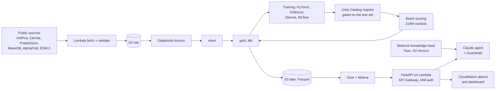

# QAFI ML Platform

A machine learning platform on AWS and Databricks for **proteome-scale variant effect prediction**. It rebuilds [QAFI](https://doi.org/10.1007/s00439-024-02692-z) (ranked first in the CAGI7 LPL and ATP7B challenges) from research scripts into the system a company would run:

- public data ingested into S3 and a governed Databricks lakehouse
- features from the ESM-2 protein language model, AlphaFold structures and physicochemical properties
- leakage-proof validation, a locked test set, MLflow tracking and a gated model registry
- **217,670,004** missense variants of the human proteome (20,652 proteins) batch-scored with a stability and a function score
- an S3/Athena lake behind a serverless, IAM-authenticated API
- a Bedrock knowledge base with cited answers and a guarded Claude agent
- everything in Terraform, CI/CD on GitHub Actions, CloudWatch alarms

## Results

All numbers are reproduced by the notebooks; models and test evaluations are in MLflow.

| What | Result |
|---|---|
| Locked test set (108 held-out proteins, 228k variants, opened once) | stability score beats zero-shot ESM-2 in 96% of stability assays (+0.20 Spearman); function score beats it in 88% of functional assays |
| Head-to-head on the test proteins, functional assays | ties AlphaMissense (0.488 vs 0.481), CPT-1 and QAFI2; beats EVE and popEVE (p < 0.01) |
| Head-to-head, stability assays (Domainome) | 0.61 vs 0.34–0.46 for all five published predictors (the model was trained on this assay type) |
| ClinVar, proteins outside all our data (117k variants) | AUROC 0.921 (zero-shot ESM-2 0.911, AlphaMissense 0.963, CPT-1 0.969): it does not beat the best published predictors on clinical pathogenicity |
| Lake and API | a lookup scans 6.5 MB of the 2.6 GB table; about 0.15 s per request when warm |
| RAG and agent | retrieval 11/11 and answers 10/11 on a fixed exam; agent 7/7 on tools, facts and refusals |
| Cost | about 2 USD for the first half of a month before credits, mostly S3 storage; serving is pay-per-request |

## Architecture



## Stack

| Platform | What it does here | Services |
|---|---|---|
| **AWS** | storage of record, security, serving, GenAI, operations | IAM, S3, KMS, Lambda, ECR, API Gateway, Glue Catalog, Athena, Secrets Manager, Bedrock (Knowledge Bases, Guardrails, Claude), S3 Vectors, CloudWatch, SNS |
| **Databricks** | data platform and ML | Unity Catalog, Delta Lake, Spark, SQL warehouse, dbt, Lakeflow Jobs, MLflow |
| Tooling | infrastructure and delivery | Terraform (72 resources), GitHub Actions with OIDC, Docker, Airflow, pytest (223 tests) |

## Key design decisions

The full list is in [`docs/plan.md`](docs/plan.md).

| Decision | Rationale |
|---|---|
| Precompute every substitution instead of real-time inference | The input space is enumerable (218M) and features are expensive, so serving becomes a lookup |
| Databricks for data and ML, AWS for storage, serving and GenAI | The split most companies run: the data platform sits on top of the cloud account |
| Raw files land in S3 first, from the publishers, with pinned versions | The cloud bucket is the system of record; every input is reproducible |
| Proteins split by sequence similarity; the test set opened once, enforced in code | Variant-level splits leak; a test set looked at twice stops being a test |
| One SQL macro computes residue features for training and serving, with a parity test for the rest | Training-serving skew is the most common silent failure |
| S3 + Athena behind the API, not a database | Read-mostly batch data: no idle cost, SQL for analysts; a cache or DynamoDB if traffic grows |
| Bedrock in Ireland, Claude through the EU inference profile | Data stays in the EU; the knowledge base, vectors and guardrail sit next to the model |

## Repository layout

```
docs/           plan and decisions
notebooks/      the guided build, one per step: A_foundation · B_data_platform · C_ml · D_serving_ai · E_wrap_up
src/            qafi_core (science) · qafi_platform (engineering: ingestion, lakehouse, API, RAG, agent, operations)
databricks/     job definitions and the notebooks they run
dbt/            dbt-databricks project: staging, marts, features, tests
airflow/        DAG that triggers the Databricks job
containers/     Dockerfiles: platform image, API image
infra/dev/      Terraform for every AWS resource
tests/          unit tests and golden tests of published numbers
```

## Status

Complete: 00 account baseline → 13 operations. Each chapter is a notebook that explains the step, runs it and records the result; see [`docs/plan.md`](docs/plan.md).
